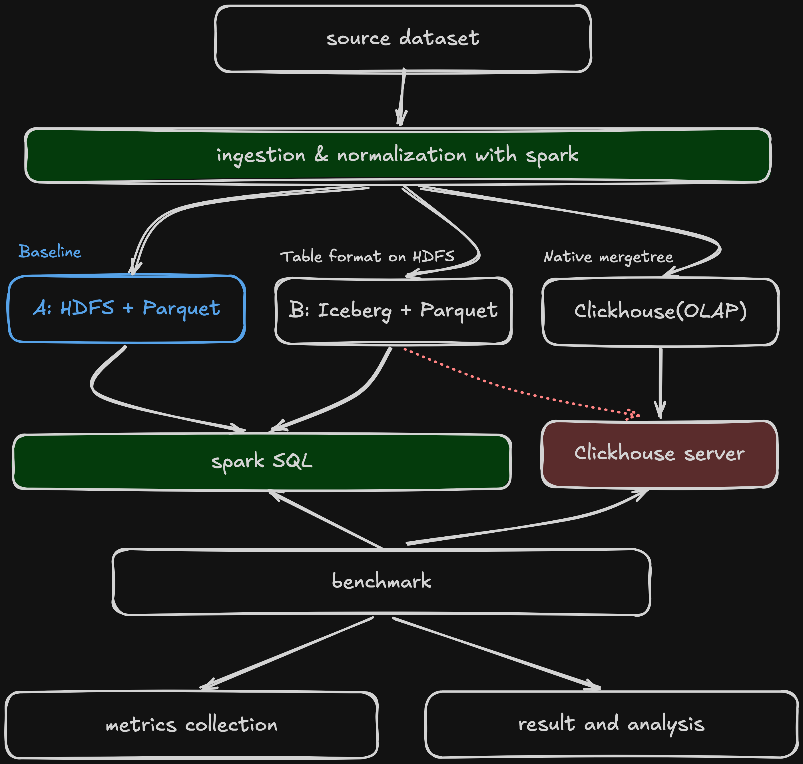

# Landslide Benchmark

Compares storage options for the NASA Global Landslide Catalog. Phase 1 turns the raw CSV into one clean Parquet dataset on HDFS at three sizes. Every storage option loads that same data later.



## Folder structure

```
compose.yaml    Starts all services on one machine
Makefile        Short commands: up, down, smoke, ingest, scale, verify
.env            Image versions and CPU and memory limits
pyproject.toml  Python packages, locked in uv.lock
conf/           Hadoop and Spark settings
data/           Raw downloaded files, not stored in git
docker/         Dockerfiles for the Hadoop and Spark images
jobs/           Spark jobs for ingest, scale up and verify
scripts/        Smoke test that checks the stack works
results/        Run records and Spark event logs
```

## Tech stack

Docker and Docker Compose: run everything on one machine
Apache Hadoop 3.4.1 (HDFS): file storage
Apache Spark 4.0.2 with PySpark: data processing
Apache Iceberg 1.11.0: table format, used in Phase 2
ClickHouse 26.8: database, used in Phase 2
Python 3.12 with uv: language and package manager
h3, pandas and pyarrow: location cells and data handling
Make: short commands for each step
